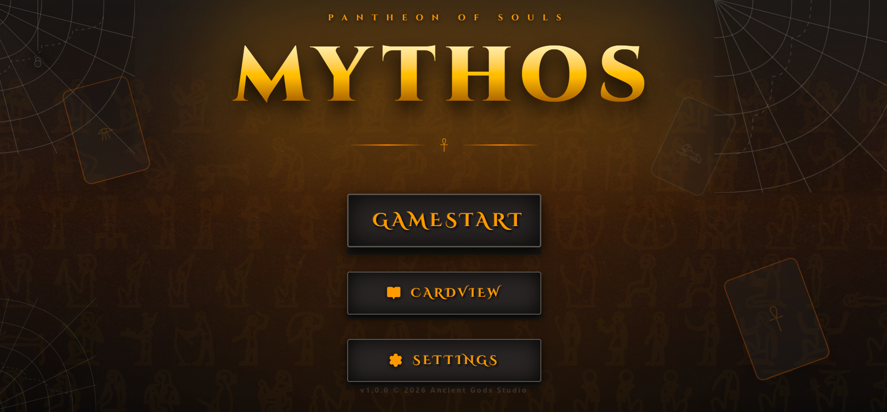
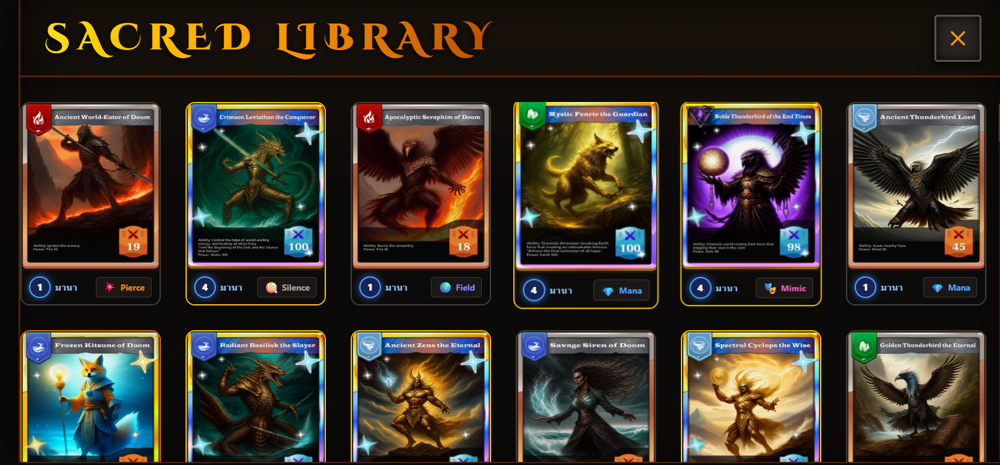
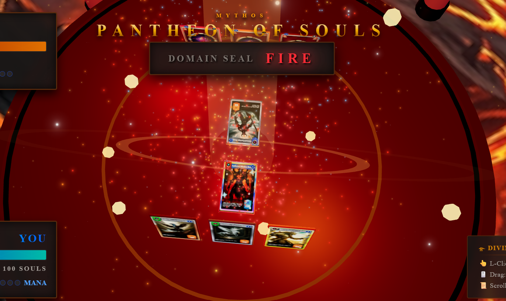
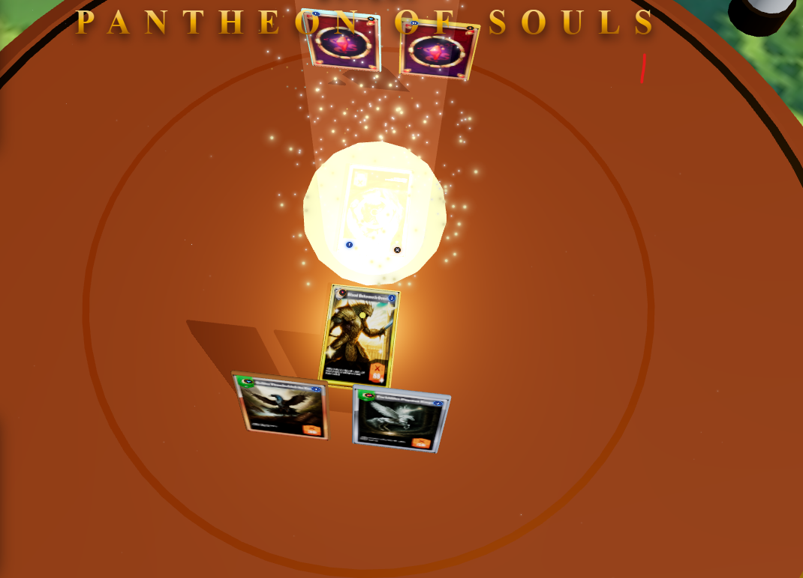

<div align="center">

# ⚔️ MYTHIC CARD CRAFT STUDIO ⚔️
**3D Holographic Card Builder built with React, TypeScript & Vite**

[](https://react.dev/)
[](https://www.typescriptlang.org/)
[](https://vite.dev/)
[](#)

---

> เว็บแอปพลิเคชันจำลองและสร้างการ์ดเกมพลังเทพ พร้อมเอฟเฟกต์ 3D Tilt และแสงสะท้อนโฮโลแกรมสมจริง

</div>

## ✨ Key Features

- **🎮 Dynamic 3D Tilt Physics:** การ์ดเอียงและสะท้อนแสงตามตำแหน่งเมาส์แบบ Real-time
- **🌈 Holographic Rainbow Foil:** เอฟเฟกต์ฟอยล์สายรุ้งด้วย CSS Blend Modes (`color-dodge`, `screen`)
- **🖼️ Drag & Drop Artwork:** ลากไฟล์รูปภาพมาวางหรืออัปโหลดเพื่อพรีวิวลงการ์ดได้ทันที
- **💎 Multi-Rarity Aura:** ระบบแสงออร่าปรับเปลี่ยนตามระดับความหายาก (`Mythic`, `Legendary`, `Epic`, `Rare`)

---

## 🃏 Card Rarity Showcase

| Rarity | Frame Accent | Glow Aura |
| :--- | :--- | :--- |
| **Mythic** | ชมพู-ม่วงคอสมิก | สว่างวาบระดับสูงสุด |
| **Legendary** | ทองคำอัศวิน | แสงประกายประกายทอง |
| **Epic** | ม่วงอเมทิสต์ | รังสีเวทมนตร์ลึกลับ |
| **Rare** | ฟ้าไพลิน | คริสตัลน้ำแข็งประกาย |

---

## 🚀 Quick Start

1. ติดตั้ง Dependencies:
   ```bash
   npm install

   <!-- ================= PREVIEW SHOWCASE ================= -->
<!-- ================= GAMEPLAY & INTERFACE SHOWCASE ================= -->
## 🎮 In-Game Showcase & Visual Experience

<div align="center">

### ⚔️ Battle Arena & Combat Showcase (สนามประลองจริง)
<!-- ภาพแบนเนอร์หลัก: จังหวะจำลองกระดานต่อสู้ แนะนำใช้ .gif หรือ .png คมชัดสูง -->


<br/>
<em>⚡ สนามประลอง Real-time Board Tactics พร้อมระบบวางการ์ดและคำนวณดาเมจ</em>
<br/><br/>

### 🕹️ Interface & Combat Previews

| 🏰 1. Main Menu (หน้าเมนูหลัก) | 🎴 2. Card View (หน้ารายละเอียดการ์ด 3D) |
| :---: | :---: |
|  |  |
| **✦ Lobby UI & Game Mode Selection**<br/>หน้าล็อบบี้เลือกโหมด PvP / PvE และคลังสำรับ | **✦ Interactive 3D Card Inspector**<br/>หมุนการ์ดดูมิติ แสงฟอยล์ และค่า Stat แบบเจาะลึก |

| ⚔️ 3. Combat Phase (จังหวะการต่อสู้) | ✨ 4. Skill & Impact Effect (เอฟเฟกต์สกิล) |
| :---: | :---: |
|  |  |
| **✦ Attack & Defense Calculations**<br/>การสั่งโจมตี ท่าสวนกลับ และตัวเลขดาเมจบนสนาม | **✦ Hologram Magic & Particle VFX**<br/>แสงอัลติเมต ลำแสงเวทมนตร์ และอนุภาคแตกกระจาย |

</div>

---
